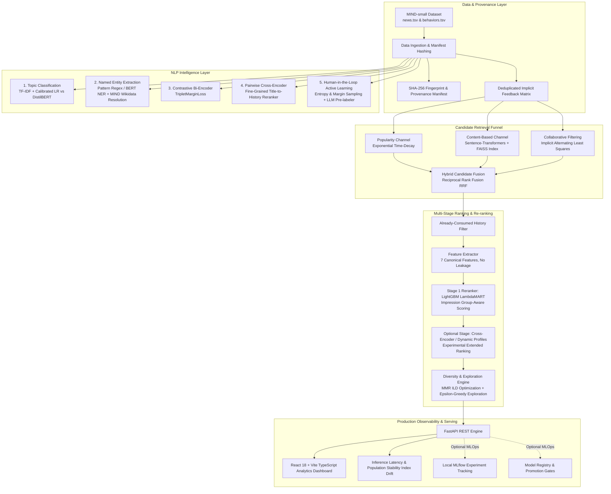

# PulseRank: Personalized Content Intelligence & Recommendation Platform (Portfolio Pass 2)

[](https://github.com/pulserank/pulserank/actions)
[](https://www.python.org/downloads/)
[](https://fastapi.tiangolo.com)
[](https://reactjs.org/)
[](https://lightgbm.readthedocs.io/)
[](https://pytorch.org/)

PulseRank is a production-style personalized content intelligence and multi-stage news recommendation platform built around Microsoft's **MIND** (Microsoft News Dataset) benchmark. It provides a defensible Machine Learning pipeline—from raw news text and interaction logs to NLP classification, contrastive representation learning, multi-channel candidate retrieval, LambdaMART learning-to-rank, paired bootstrap hypothesis testing, and active learning—surfaced through a FastAPI backend and a clean, high-density React/TypeScript analytical dashboard.

---

## High-Level System Architecture



---

## What Makes PulseRank Scientifically & Mathematically Defensible

1. **Strict Separation of Catalog Discovery vs. Impression Ranking**:
   - Conflating whole-catalog retrieval with impression ranking is a frequent industry mistake.
   - PulseRank evaluates impression ranking (MIND standard: AUC, MRR, nDCG@5, nDCG@10) strictly among candidates presented within each session. Whole-catalog retrieval (HitRate@10, Recall@10, Catalog Coverage) is evaluated independently without temporal contamination.
2. **Feature Sanitation & Zero Leakage**:
   - Constant freshness and production-only features were completely eliminated from the training path.
   - The feature extractor uses 7 canonical features aligned identically across offline training and live feed serving: `content_score`, `collab_score`, `popularity_score`, `category_affinity`, `subcategory_affinity`, `entity_overlap`, and `user_history_len`.
3. **Explicit User History Pass-Through**:
   - Inference routes live user interaction histories directly to ranking feature extraction, guaranteeing that cold-start and warm-profile updates immediately influence recommendation scores.
4. **Statistical Hypothesis Testing**:
   - Replaces naive metric comparison with paired bootstrap hypothesis testing (95% bootstrap confidence intervals, empirical $p$-values with configurable resamples, engine default 500).
   - Built-in two-sample proportion A/B sample-size power calculator with minimum detectable effect (MDE) sizing.
5. **Systematic 9-Configuration Ablation Study**:
   - Quantifies the marginal value of every layer across ranking quality (AUC, MRR, nDCG@5), Intra-List Diversity (ILD), Novelty, and Catalog Coverage:
     1. `1. Popularity Baseline` (Pure global recency-decayed popularity)
     2. `2. Content-Based Policy (popularity cold-start fallback)` (Dense semantic similarity via Sentence-Transformers)
     3. `3. Collaborative Filtering Policy (popularity cold-start fallback)` (Implicit ALS matrix factorization)
     4. `4. Pointwise Hybrid` (Calibrated linear blend of content, collaborative, and popularity)
     5. `5. RRF Candidate Fusion` (Within-impression Reciprocal Rank Fusion)
     6. `6. Full LTR Ranker` (LightGBM LambdaMART on 7 canonical leakage-free features)
     7. `7. LTR + Dynamic Profiles` (Dedicated LambdaMART trained & evaluated with dynamic recency profiles)
     8. `8. LTR + MMR Diversity` (LTR reranked with Maximal Marginal Relevance, lambda=0.7)
     9. `9. Experimental Full Policy` (Dynamic-profile LambdaMART + MMR + Principled Catalog Exploration, seed=42)
6. **Provenance & Dataset Fingerprinting**:
   - Every trained artifact emits a JSON manifest containing SHA-256 hashes of input datasets, hyperparameter configurations, Git commit context, and timestamp provenance.
   - When running on synthetic fixtures, metrics explicitly disclose: `[Demo Fixture - Not a MIND Benchmark Result]`.

---

## Directory Structure

```text
PulseRank/
├── pulserank/
│   ├── api/                 # FastAPI routers, app factory, dependencies
│   │   └── routes/          # feed, nlp, experiments, ablations, monitoring, etc.
│   ├── data/                # Ingestion, MIND TSV parsing, provenance manifest
│   ├── db/                  # SQLAlchemy 2.0 models and session management
│   ├── ml/                  # ML engines
│   │   ├── ranker.py        # LightGBM LambdaMART ranker & feature extractor
│   │   ├── content_based.py # Sentence-Transformers + FAISS IndexFlatIP
│   │   ├── collaborative.py # Implicit ALS matrix factorization
│   │   ├── popularity.py    # Recency-decayed popularity baseline
│   │   ├── hybrid.py        # Pointwise ensemble & Reciprocal Rank Fusion
│   │   ├── profiles.py      # Dynamic profile manager (recency decay + drift)
│   │   ├── diversity.py     # MMR, Intra-List Diversity, Entropy, Novelty
│   │   ├── exploration.py   # Epsilon-greedy slate exploration & UCB1
│   │   ├── cold_start.py    # Onboarding persona generator & cold-item boost
│   │   ├── ablation.py      # Systematic 9-configuration ablation study
│   │   ├── experimentation.py # Paired bootstrap hypothesis testing & sample-size
│   │   ├── segment_analysis.py # Failure archetype analyzer & demographic slices
│   │   ├── monitoring.py    # Inference latency percentiles & PSI drift
│   │   ├── registry.py      # Model registry with promotion gates
│   │   └── tracking.py      # Local MLflow experiment tracking
│   ├── nlp/                 # NLP Intelligence Layer
│   │   ├── classifier_baseline.py    # TF-IDF + Logistic Regression (calibrated)
│   │   ├── classifier_transformer.py # DistilBERT topic classification
│   │   ├── ner.py                    # Named entity extraction & Wikidata resolver
│   │   ├── semantic_matching.py      # Contrastive Bi-Encoder (TripletMarginLoss)
│   │   ├── cross_encoder.py          # Pairwise Cross-Encoder reranker
│   │   └── annotation.py             # Active learning queue & Cohen's Kappa
│   └── scripts/             # End-to-end CLI runner & training scripts
│       └── run_pipeline.py  # Unified orchestrator (--mode quick / full)
├── web/                     # React 18 + Vite TypeScript analytical dashboard
│   ├── src/
│   │   ├── components/      # 9 analytical views (Feed, Ablations, Active Learning, etc.)
│   │   └── api/client.ts    # Type-safe API client
│   └── dist/                # Production frontend bundle (served by FastAPI)
├── migrations/              # Alembic database migrations
├── tests/                   # Complete 57+ test suite covering all engines
└── docs/
    └── INTERVIEW_DEEP_DIVE.md # Architectural trade-offs and mathematical derivations
```

---

## Quickstart & CLI Pipeline Runner

### 1. Installation

```bash
# Create virtual environment
python -m venv .venv

# Activate environment
# Windows:
.\.venv\Scripts\activate
# Linux/macOS:
source .venv/bin/activate

# Install dependencies
pip install -r requirements.txt
pip install -e .

# Build frontend production bundle
cd web
npm install
npm run build
cd ..
```

### 2. End-to-End Pipeline CLI

PulseRank includes a unified orchestration CLI to ingest data, train core recommender models (Popularity, Content embeddings, Implicit ALS collaborative filtering, LambdaMART ranker, and TF-IDF topic classifier baseline), run evaluations, execute ablation benchmarks, and log provenance in a single automated pass:

```bash
# Quick verification mode (runs complete pipeline in ~8 seconds using CPU fixtures)
python -m pulserank.scripts.run_pipeline --mode quick

# Full recommender mode (trains core recommender models on MIND corpus, full LambdaMART ranker, and complete 9-stage ablation study; Transformer NLP models are separate optional workflows)
python -m pulserank.scripts.run_pipeline --mode full
```

### 3. Launch the Server

```bash
uvicorn pulserank.api.app:app --host 0.0.0.0 --port 8000 --reload
```

Open your browser at:
- **Interactive RecSys Dashboard**: [http://localhost:8000/](http://localhost:8000/)
- **Interactive OpenAPI Docs**: [http://localhost:8000/docs](http://localhost:8000/docs)

---

## Frontend Dashboard Features

The React 18 + TypeScript web interface provides 9 specialized analytical interfaces:

1. **Personalized Feed & Live Explanations**: Real-time multi-stage ranking with interactive Maximal Marginal Relevance (MMR) diversity slider, $\epsilon$-greedy exploration injection, and transparent feature attribution breakdowns.
2. **User Profiles**: Real-time reading history, category/subcategory distributions, Wikidata entity affinities, and semantic summary vectors.
3. **Model Benchmarks**: Head-to-head impression-level evaluation table (AUC, MRR, nDCG@5, nDCG@10) and catalog discovery table with dataset provenance badges.
4. **Content AI (NLP Studio)**: Interactive topic classification comparing TF-IDF + Logistic Regression vs. DistilBERT, alongside Named Entity Recognition with MIND Wikidata entity resolution.
5. **Ablation Laboratory**: Interactive results table for the 9-configuration ablation study with ranking accuracy, Intra-List Diversity (ILD), and Novelty metrics.
6. **A/B Stats & Hypothesis Testing**: Interactive paired bootstrap hypothesis testing with empirical $p$-values and an A/B sample-size power calculator.
7. **Cold-Start Studio**: Interactive persona builder to simulate onboarding category priors and analyze cold-user segment slicing.
8. **Inference Monitoring**: Real-time mean and P95 latency tracking, prediction entropy distributions, and Population Stability Index (PSI) category drift alerts.
9. **Active Learning Queue**: Uncertainty queue triage (entropy and margin sampling), Mock LLM pre-labeler rationale, and Inter-Annotator Agreement (Cohen's $\kappa$) calculation.

---

## Running Tests

Execute the complete test suite:

```bash
pytest tests -v
```

The complete pytest test suite passes with zero failures:
- Scientific impression-level metric precision (AUC, MRR, nDCG@K, Recall@K)
- Strict train/serve feature parity across all 7 LTR canonical features
- Fail-closed artifact provenance validation preventing stale artifact loading
- Candidate fusion provenance tracking and deduplication
- NLP topic classifiers, calibrated Platt scaling, and Wikidata entity resolution
- Dynamic profiles, MMR diversity, cold-start boosting, and $\epsilon$-greedy exploration
- Paired bootstrap hypothesis testing, sample-size sizing, and PSI drift calculations
- Real Active Learning DB persistence and transactional safety
- FastAPI endpoints and Alembic schema migrations

---

## References & Documentation

For in-depth explanations of the mathematical derivations, ranking loss formulations, and systems trade-offs, consult:
- [INTERVIEW_DEEP_DIVE.md](file:///docs/INTERVIEW_DEEP_DIVE.md): Technical deep-dive covering LambdaMART listwise gradients, TripletMarginLoss, Cohen''s Kappa derivations, PSI drift equations, and distributed serving architectures.
